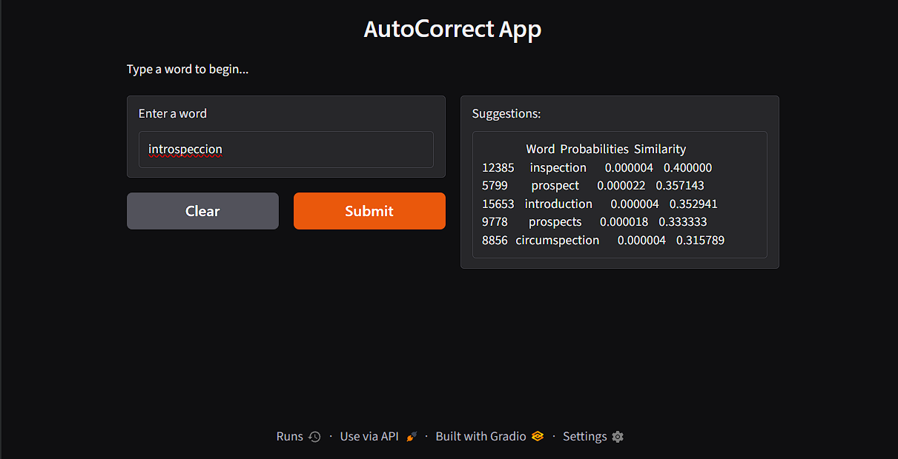

# AutoCorrectFeature
As our smartphone uses past history to match the typed words whether it is correct or not. Here, I have tried implementing the same feature.
As we have taken words from a book 'moby.txt'. In the same way there are some words that are already present in the vocabulary of a smartphone and then some words it records while the user starts typing using the keyboard.

## Working Demo

